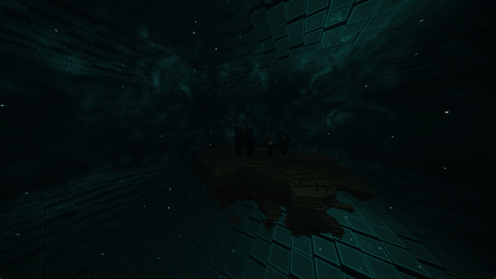
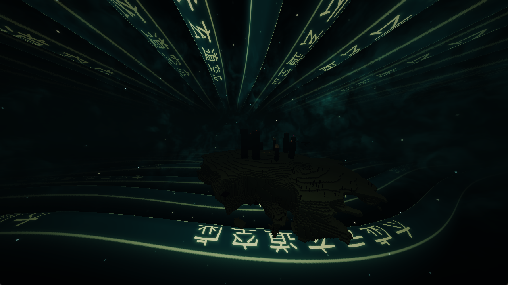
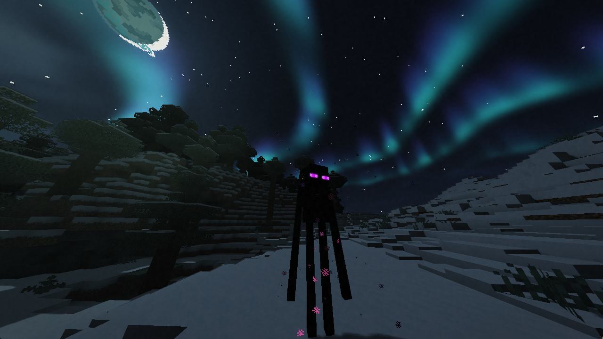
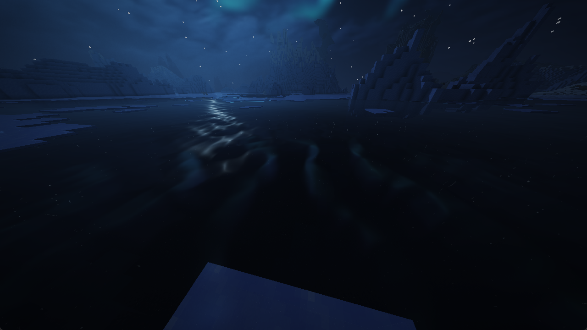
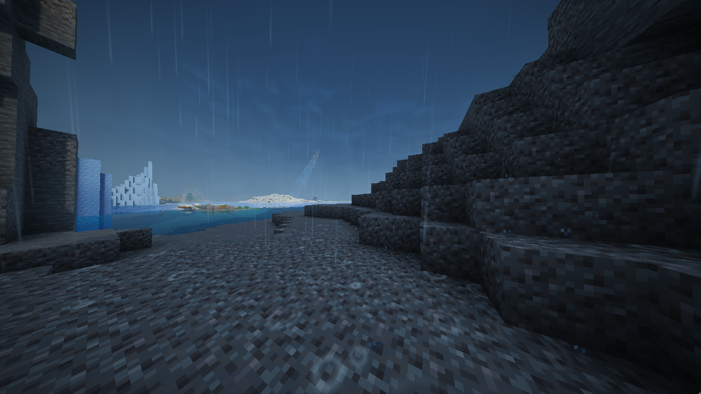
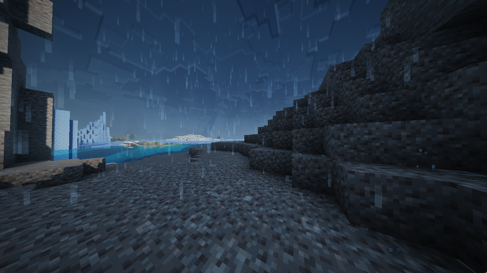
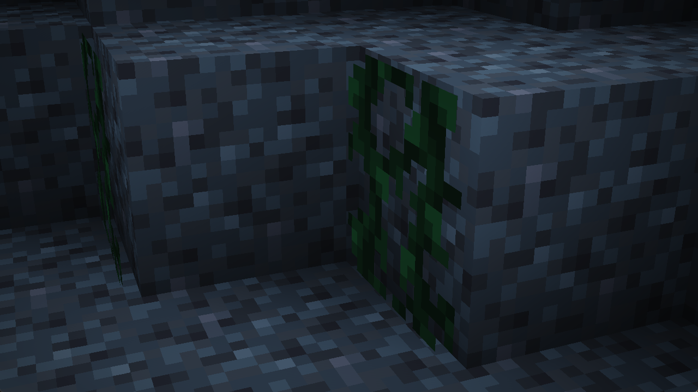

# YunMeng Shaders 0.1.0-alpha.7 — Screenshots

**CurseForge changelog link:** [View Alpha 7 screenshots](https://github.com/FPJRICE/YunMeng-Shaders/blob/main/release-media/0.1.0-alpha.7/README.md)

The End sky, mob eyes, star reflections, rain, and foliage captures show **Xianxia Mist**. The rain images compare **Wuxia Smooth** and **Minecraft Voxel** rendering styles. The moon image shows **Guofeng Ink**.

## Custom End Sky — Xianxia Mist

*Wide view of the starfield, void island, and surrounding End sky.*

*Closer view of the glowing glyphs integrated into the End sky.*

## Guofeng Moon — New Moon

*Guofeng Ink's new moon phase in-game. The other moon phases are not shown here.*

## Glowing Mob Eyes — Xianxia Mist

*Enderman eyes and emissive accents stand out against the night sky.*

## Night Star Reflections — Xianxia Mist

*The night sky's stars shimmer in the water reflection.*

## Rain — Xianxia Mist

### Wuxia Smooth

*Fine rain streaks blend into the distant mist and wet shoreline.*

### Minecraft Voxel

*Chunkier rain shapes preserve the voxel look.*

## Attachment-Based Foliage Sway — Xianxia Mist

*Wall-attached vines stay anchored to the block instead of swaying through it; foliage that hangs freely can still sway.*
